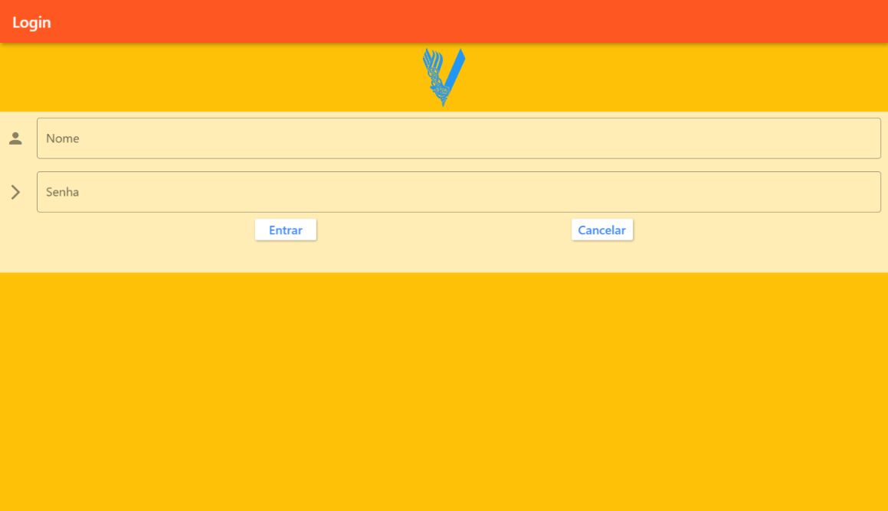
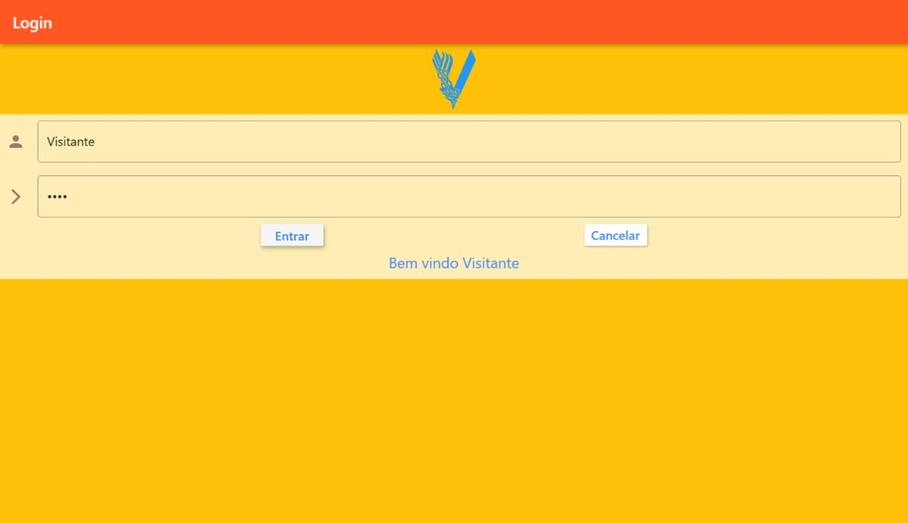

# Interface de Login em Flutter

Exemplo visual de formulário de login com campos de nome e senha, ações de entrada e cancelamento e uma saudação apresentada na própria tela. O projeto exercita leitura dos campos e atualização da interface.

**Categoria:** Frontend · Aplicativo móvel · Protótipo de interface.

## Tecnologias principais

- Dart 2
- Flutter

## Comportamento da tela

- O campo de nome recebe o texto usado na saudação.
- O campo de senha oculta os caracteres digitados.
- A ação **Entrar** exibe “Bem vindo” seguido do nome informado.
- A ação **Cancelar** limpa os campos e o estado do formulário.
- O projeto inclui uma imagem local em `assets/v.png` e uma composição visual com cores e widgets Material.

## Escopo

O botão de entrada demonstra o comportamento da interface. Não há verificação de credenciais em servidor, emissão de token ou cadastro persistido. A senha digitada não transforma este exemplo em um sistema de autenticação completo.

## Organização

A aplicação está em `lib/`. O `pubspec.yaml` declara o pacote `cadastro`, os recursos de imagem e as dependências Flutter. Android e iOS são os destinos presentes no projeto original.

## Executar

Use Flutter com Dart 2, respeitando a restrição `>=2.7.0 <3.0.0`. Com um dispositivo ou emulador configurado:

```bash
flutter pub get
flutter run --no-sound-null-safety
```

A migração para Flutter com Dart 3 exige adequação do código e das dependências.

## Execução das capturas

Foi utilizado Flutter 2.10.5 com um destino web gerado apenas na cópia local. As imagens mostram a página inicial e a saudação após informar o nome “Visitante” e acionar **Entrar**. Nenhum backend foi simulado ou associado à tela.

## Relação com outros projetos

Exemplo independente de interface. Não corresponde ao login dos projetos Spring ou Ionic desta coleção.

## Capturas do sistema

Capturas reais obtidas em execução local em 12/10/2026.

### Página inicial



### Saudação exibida pela interface



## Histórico

Repositório criado no GitHub em **2021-02-24**. Essa data identifica a criação do repositório; não comprova o início nem a conclusão do desenvolvimento.
